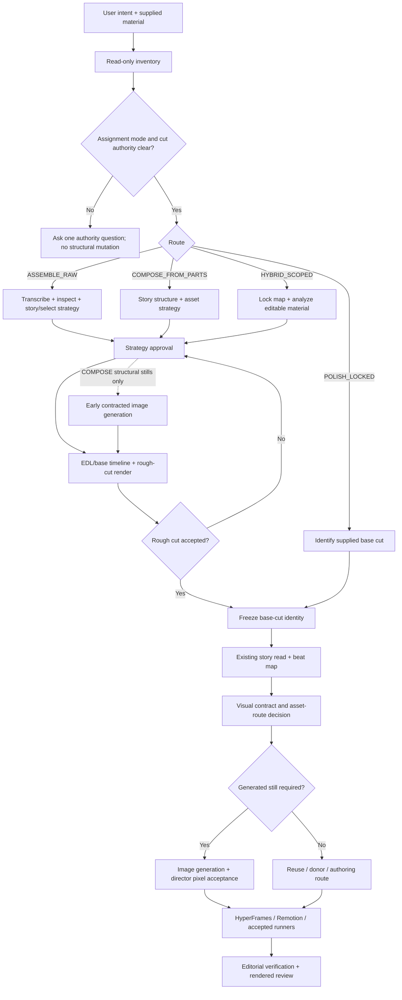

# Input Routing and Base-Edit Authority

## Decision

Add a small, provider-neutral **assignment router** in front of the system's existing
creative-director workflow. The router classifies the user's intent and supplied
material, records the director's cut authority, and chooses whether the project may:

1. polish a supplied cut without changing its editorial structure;
2. assemble raw footage into a reviewed rough cut;
3. compose a base edit from a script, voice-over, stills, screen recordings, or mixed
   media; or
4. work under explicitly scoped permissions when a partial cut and additional raw
   material are supplied together.

The new routes do not create a second editing system. Assembly and composition produce
a reviewed, identified rough cut and then converge into the current visual-polish
pipeline. Existing project skills, HyperFrames, Remotion, FFmpeg, and selected Video
Use patterns remain execution options under one director's judgment.

the project lead approved this direction and written specification in conversation on
2026-07-16.

## Why this is needed

The current director instructions assume the user supplies a rough cut and say
"add; do not recut." That boundary is correct when the cut exists and the user wants
polish. It becomes a false universal rule when the user supplies twelve raw takes,
voice-over plus a script, or a half-finished edit with pickups.

The project already has most of the required capabilities:

- immutable source handling, media inventory, contact sheets, and frame inspection;
- local MLX Whisper Large V3 transcription with word timings;
- shot, beat, speech/music/silence, and presenter analysis;
- Video Use's useful selection, EDL, boundary-padding, and rendered-review patterns;
- accepted masking, compositing, camera, caption, audio, and presenter-world skills;
- visual contracts, contextual still generation, HyperFrames, Remotion, and FFmpeg.

The missing layer is not another tool. It is an explicit rule for how much editorial
control the user has granted and which sequence of existing capabilities is allowed.

## Governing principles

### User intent outranks file type

A raw clip is not automatic permission to recut it. A rendered MP4 is not proof that
its structure is locked. Route from the user's requested outcome and explicit
authority, using the supplied files as evidence rather than as the decision itself.

### Authority is recorded before mutation

Read-only inventory and analysis are allowed before the route is confirmed. Selecting,
shortening, reordering, replacing, or creating editorial timing begins only after the
cut authority is unambiguous.

### One director owns story and taste

The user's chosen director model retains the complete story read, route decision,
selects, structure, visual direction, and final acceptance. A skill, repository,
renderer, image model, or optional worker is not another director. Bounded extraction
or deterministic rendering may be delegated under the existing model policy.

### All routes converge

Assembly, composition, and scoped-hybrid work stop being special after their rough cut
has been reviewed and frozen. From that point they use the same story, beat-map, visual
contract, image-generation, build, and verification process as a supplied rough cut.

### Reuse first; custom code last

The router changes authorization and order, not the engine policy. Consult
`skills/CATALOG.md` and accepted runners first, then local HyperFrames, Remotion where
alpha or per-frame work requires it, and FFmpeg for deterministic media/audio/assembly.
Use Video Use's proven orchestration patterns selectively. Do not alter or depend on
the vendored repository, and do not install a new tool without explicit authority.

## The four modes

Canonical mode names are stable machine-readable labels. Human-facing explanations
may be plain language.

| Mode | Typical input and request | Cut authority | Required outcome before visual polish |
|---|---|---|---|
| `POLISH_LOCKED` | A supplied edit or rough cut; "package this," "add graphics," or "make it pop" | Preserve selection, order, and editorial timing unless a separate change is authorized | The supplied cut is the base-cut identity |
| `ASSEMBLE_RAW` | Raw clips, multiple takes, interviews, or a long recording; user asks for a reel/edit | Select, shorten, reorder, and assemble within the approved story target | Reviewed rough cut plus EDL/select record |
| `COMPOSE_FROM_PARTS` | Script, voice-over, audio, stills, screen recordings, data, or mixed source material; user asks to create the piece | Create story structure and a base timeline within the approved brief | Reviewed rough cut plus asset/structure record |
| `HYBRID_SCOPED` | Partial edit plus raw pickups, replacement sections, or optional material | Preserve locked areas and change only named sections/sources | Reviewed rough cut plus an explicit locked/editable scope map |

These modes describe authority, not quality or engine. No mode is "more creative" by
default. The director applies judgment within the granted boundary.

## Route contract

Before changing editorial structure, record this compact route contract in the edit's
working log:

```yaml
assignment_mode: POLISH_LOCKED | ASSEMBLE_RAW | COMPOSE_FROM_PARTS | HYBRID_SCOPED
requested_outcome: <plain-language user goal>
cut_authority: locked | assemble | compose | scoped
color_authority: unchanged | explicit
requested_color_work: none | <exact user request>
locked_material: <files, timelines, sections, or none>
editable_material: <files, timelines, sections, or none>
target_length_or_platform: <known value or unresolved>
story_source: supplied-cut | supplied-brief | transcript-derived | mixed
required_review_gate: supplied-base | strategy-and-rough-cut | scoped-rough-cut
unresolved_authority: <none or exact question>
```

If `unresolved_authority` is not `none`, the director may inventory and analyze but may
not make structural cut decisions. Ask one concrete question that distinguishes the
plausible routes.

Color authority is independent of cut authority and defaults to `unchanged` for every
mode. Set it to `explicit` only when the user specifically requests color correction,
grading, relighting, recoloring, a LUT, or a named color adjustment. Broad style
language such as “cinematic,” “visual polish,” or “make it pop” does not authorize
changing source-footage color. With `unchanged`, all engines omit footage color
transforms; technical color-space conversion is allowed only to preserve the source
appearance and must be documented and visually matched.

## Routing decision table

Apply the first row whose intent and authority are supported by the user's request.

| Evidence | Route | Action |
|---|---|---|
| User supplies a cut and asks only for visual/audio packaging | `POLISH_LOCKED` | Preserve the base edit and enter the existing polish workflow |
| User explicitly asks to turn raw footage or multiple takes into a reel/edit | `ASSEMBLE_RAW` | Analyze, propose the story/select strategy, obtain strategy approval, then assemble |
| User explicitly asks to create a video from a script, voice-over, notes, stills, or mixed parts | `COMPOSE_FROM_PARTS` | Design the story/asset structure, obtain strategy approval, then build the base edit |
| User names both protected material and sections/sources that may change | `HYBRID_SCOPED` | Record a locked/editable scope map and alter only the editable region |
| The files suggest more than one route but the request does not grant cut authority | unresolved | Inventory only, state the likely routes, and ask what may change |
| The requested job is unfamiliar but authority is clear | nearest supported mode | Decompose the job into catalogued capabilities and report any genuine missing dependency |

Do not choose `ASSEMBLE_RAW` merely because a folder contains raw media. Do not choose
`POLISH_LOCKED` merely because the user supplied one flattened video.

## Process graph



The dotted branch is a narrow exception explained below. Image generation is otherwise
after the base cut is frozen and the beat's visual contract has selected
`generated-still`.

## Stage A — route and inventory

The director:

1. reads the user request before inspecting filenames;
2. inventories supplied media without modifying it;
3. records the route contract;
4. reports the selected mode in plain language; and
5. asks only if the permission boundary is genuinely ambiguous.

Inventory may include duration, codec, dimensions, streams, checksums/fingerprints,
contact sheets, and transcript availability. Originals remain immutable. Derived work
lives under the edit's working directory, never beside or over source files.

## Stage B — create a base edit when needed

This stage runs only for `ASSEMBLE_RAW`, `COMPOSE_FROM_PARTS`, and the editable portion
of `HYBRID_SCOPED`.

### Mechanical facts

- transcribe speech with the project's local MLX Whisper **Large V3**, word timestamps
  on; do not adopt Video Use's Scribe/API transcription default;
- run shot detection, audio analysis, and contact-sheet extraction as relevant;
- preserve source fingerprints and timecode provenance;
- use word-boundary cuts, short boundary padding, fades, and rendered boundary checks
  where Video Use's patterns fit the job;
- apply Hinglish romanization and the zero-Devanagari rendered check when Hindi speech
  becomes on-screen text.

### Director judgment

The director defines the story target, selects takes/evidence, orders material, decides
what may be omitted, and records why the structure serves the user's brief. For
multiple takes, retain a selects/EDL record that maps every used range to its source.

### Strategy gate

Before cutting, show a concise, user-facing strategy: intended story, likely structure,
selection rule, protected material, target duration, and important uncertainty. This is
an approval of editorial direction, not a demand that the project lead review internal planning
documents. A direct instruction that already specifies these choices can satisfy the
gate when recorded in the route contract.

### Rough-cut gate

Render the base edit and present it in the user's review surface. Do not begin expensive
polish until the rough cut is accepted. On acceptance, record:

- rough-cut file and SHA-256 (or stable timeline/version identity);
- source manifest/fingerprints;
- EDL/selects or structure record;
- assignment mode and cut authority;
- locked/editable scope where applicable;
- known issues intentionally deferred to polish; and
- acceptance status/date.

This becomes the supplied base cut for the downstream workflow. Later structural
changes reopen the rough-cut gate and produce a new identity.

## Where image generation occurs

Image generation is a **capability node**, not an intake mode, editor, or renderer. The
director invokes it only when a story/beat decision needs a contextual still and the
visual contract's route is `generated-still`.

### Default placement: after rough-cut acceptance

For `POLISH_LOCKED`, `ASSEMBLE_RAW`, `HYBRID_SCOPED`, and ordinary polish work in
`COMPOSE_FROM_PARTS`, the sequence is:

```text
accepted/frozen base cut
  -> story and beat decision
  -> visual design contract
  -> plan check
  -> image brief derived from the contract
  -> native image-generation ability
  -> director pixel acceptance or one re-brief
  -> accepted still in assets-generated/
  -> animation/compositing in HyperFrames or Remotion
  -> editorial verification
```

The generator may create a background, illustration, photographic plate, isolated
cutout, or missing texture. It does **not** decide the story, source selection, cut,
timing, depth, typography, or motion. Those remain director and renderer decisions.

### Narrow early placement: structural stills in `COMPOSE_FROM_PARTS`

A composition made from voice-over, a script, or sparse media may be impossible to
review without representative visual plates. After the story/asset strategy is
approved, the director may generate only the stills required to make the base edit
legible. Each still requires a visual contract and pixel acceptance.

Use placeholders when they are sufficient to judge pacing. Generate final structural
stills early only when the actual composition or content materially affects the rough
cut. After rough-cut acceptance, re-check those assets against the frozen timing and
replace/re-brief them if needed. This exception is not permission to polish the whole
film before its structure is approved.

### Privacy and provenance

Text-only briefs remain the default. Uploading unpublished footage frames as references
requires the project lead's per-asset approval. Accepted images retain provider, date, contract
ID, optional donor ID, full brief, and SHA-256 provenance under the existing
`generate-image` contract.

## Unexpected jobs and clean fallback behavior

When the user's request does not match a named workflow:

1. classify the requested result and the granted authority;
2. decompose it into editing jobs rather than repository names;
3. consult `skills/CATALOG.md` before proposing new implementation;
4. reuse accepted analysis assets and portable contracts;
5. use the nearest supported assignment mode if the authority matches;
6. state an exact missing dependency or permission when one genuinely exists; and
7. propose custom code only after the accepted runner, HyperFrames, Remotion, and
   FFmpeg routes are insufficient.

If the material does not support a coherent story, say so and identify the missing
information. Do not manufacture claims, silently invent user intent, or turn every
unknown request into an installation task.

## Failure and recovery rules

- **Ambiguous cut permission:** inventory only; ask before selecting or changing cuts.
- **Missing or unreadable source:** report the exact file/stream problem and preserve
  the rest of the analysis.
- **Low-confidence transcript:** follow existing ASR QC; do not build precise word cuts
  on unverified timings.
- **No viable story from the supplied facts:** present the gap or competing honest
  structures; do not fabricate connective evidence.
- **Rough cut rejected:** revise structure/EDL and re-render; do not hide the issue with
  graphics.
- **A locked area must change:** request expanded scope and create a new route contract.
- **Color work was not specifically requested:** preserve source-footage color; never
  infer grading authority from style language.
- **Generated image fails twice:** change asset route rather than accumulating prompt
  patches.
- **Missing tool or provider:** state what is missing and the available fallback; do not
  install or upload material without authority.
- **Source safety:** never overwrite originals. New outputs and analysis are derived
  artifacts with provenance.

## Required scenario tests

The documentation implementation is not accepted until these examples route
unambiguously:

1. **Finished rough cut + "make it pop":** `POLISH_LOCKED`; no structural recut; image
   generation only after a beat and visual contract justify it.
2. **Twelve raw takes + "make a 45-second reel":** `ASSEMBLE_RAW`; strategy approval,
   selects/EDL, rough-cut review, then polish.
3. **Script + voice-over + stills:** `COMPOSE_FROM_PARTS`; story/asset strategy, optional
   early contracted structural stills, rough-cut review, then final polish assets.
4. **Partial cut + raw pickups for the middle section:** `HYBRID_SCOPED`; opening/end
   locked, named middle editable, new rough-cut identity before polish.
5. **Unlabelled media folder + "see what you can do":** unresolved authority; read-only
   inventory and one concrete routing question before structural editing.

## Non-goals

This change does not authorize:

- an automated planner, editing factory, or autonomous publication workflow;
- silent recutting or inferred permission from media type;
- a new renderer, vendored dependency, provider, or installation;
- replacing director judgment with multiple agents or repository-specific agents;
- changing the project transcription standard to Video Use's default;
- image-to-video generation; generated assets remain stills animated by the renderer;
- source-specific template stockpiling; capability knowledge remains derivation recipes;
- automatic recutting inside `POLISH_LOCKED`.

## Canonical documentation changes after approval

Implementation will:

1. add `docs/rulebook/input-routing.md` as the read-first operational routing rule;
2. insert route/authority Stage 0 and the conditional base-edit branch into
   `docs/rulebook/orchestration-runbook.md`;
3. scope "add; do not recut" in
   `docs/rulebook/creative-director-instructions.md` specifically to
   `POLISH_LOCKED`, while preserving all current polish rules after convergence;
4. link the router from `CLAUDE.md`, `skills/CATALOG.md`, and the private handoff log without
   presenting it as a runnable skill;
5. preserve the 2026-07-15 pipeline design as historical scope rather than rewriting
   its original decision; and
6. change no vendored engine, model, provider, dependency, or source-media file.

## Verification after implementation

- all canonical links resolve;
- the four mode names and four authority values are consistent across every changed
  document;
- every unconditional "do not recut" instruction is either retained as a
  `POLISH_LOCKED` rule or clearly described as historical scope;
- all raw/compose/hybrid paths pass strategy and rough-cut review before full polish;
- the default image-generation node remains after visual-contract selection and plan
  validation, with only the documented structural-still exception;
- local MLX Whisper Large V3 remains the project transcription authority;
- all five scenario tests produce the expected route and gates;
- no vendored repo, dependency, source video, or unrelated workbench file changes.
